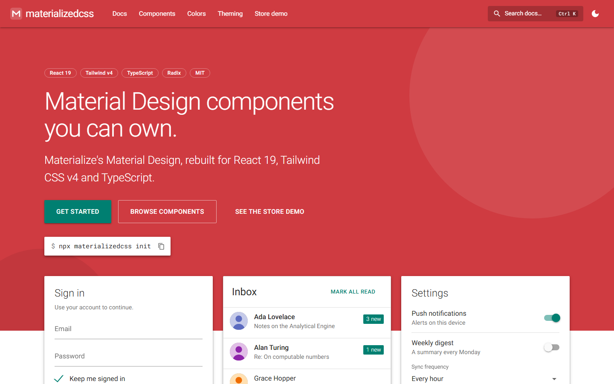
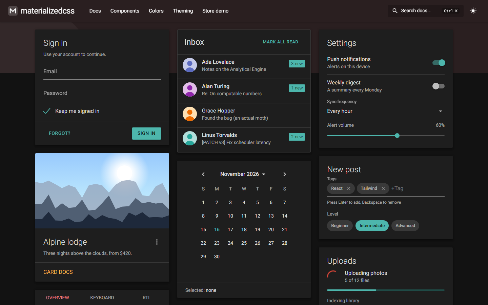
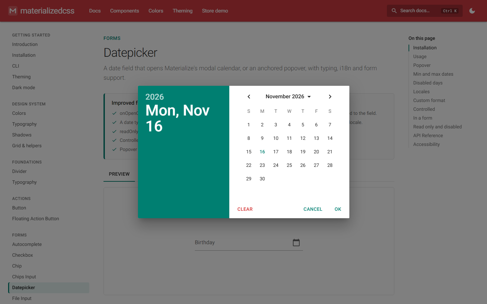
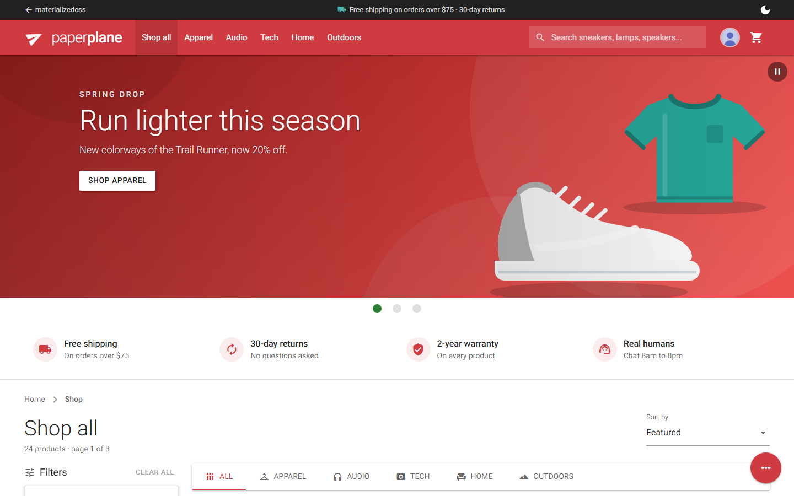

<div align="center">


# materializedcss

**The Materialize design you loved, rebuilt for React 19, Tailwind CSS v4 and TypeScript.**

Copy the components into your app with one command, or install them from npm.

**[Docs and live demos →](https://muhibahmed.github.io/materializedcss/)**


[](https://www.npmjs.com/package/materializedcss)




</div>

## The story

Seven or eight years ago, [Materialize](https://github.com/Dogfalo/materialize) was my favorite CSS framework. Bootstrap was the one everybody used back then, but I kept choosing Materialize because it looked *so* good. It had ripple effects on every button, soft z-depth shadows on the cards, floating labels on the inputs, and a full set of ready-made components: modals, date pickers, toasts, side navs and more. You dropped them in and the page looked finished.

A big shout-out to **[Alvin Wang (@Dogfalo)](https://github.com/Dogfalo)**, who created Materialize, and to everyone who worked on it with him. That project made a lot of us care about how our side projects looked. ❤️

Then [Tailwind CSS](https://tailwindcss.com) arrived, and its JIT compiler changed how most of us write CSS. Utility classes won, and component frameworks like Materialize and Bootstrap slowly faded from new projects.

This week I had an idea: **why not have both?** I kept the Materialize design system I loved and rebuilt it on Tailwind CSS. I modernized the internals and fixed the bugs that were never fixed upstream. **materializedcss** is the result: the same look, built on today's tools.

## What you get

- 🎨 **The same Material look.** Waves ripples, z-depth shadows, floating labels, the Materialize color palette and the MD1 motion. There is no jQuery and no anime.js.
- ⚛️ **Modern React.** React 19, TypeScript, Tailwind CSS v4 tokens and Radix primitives under the hood.
- 📋 **You own the code.** `npx materializedcss add button` copies the component source into your project, [shadcn/ui](https://ui.shadcn.com) style. You can also import the same components from the npm package.
- ♿ **Accessible by default.** Overlays, menus, selects, tabs and accordions follow WAI-ARIA patterns with full keyboard support. Every docs page passes an axe scan.
- 🐛 **Old bugs fixed.**
  - Select no longer picks the wrong option when tapped on iOS.
  - Dropdowns are no longer clipped inside modals.
  - Tab indicators no longer drift, and tooltips no longer get stuck open.
  - Toasts, tooltips and autocomplete are no longer open to XSS.
  - Each component's docs page lists exactly what changed.
- 🌗 **Themeable.**
  - Colors are semantic CSS variables, and dark mode is built in.
  - Reduced-motion preferences are respected.
  - The default palette meets WCAG AA contrast.

<table>
  <tr>
    <td></td>
    <td></td>
  </tr>
  <tr>
    <td align="center"><sub>Dark mode, built in</sub></td>
    <td align="center"><sub>The classic Materialize datepicker, now keyboard- and screen-reader-friendly</sub></td>
  </tr>
</table>

## Use it in any React app

It works anywhere React 19 and Tailwind CSS v4 work: Next.js, Vite, React Router and Astro, or a custom setup.

### Option 1: copy the components (recommended)

```bash
npx materializedcss init
npx materializedcss add button card text-field toast
```

`init` detects your framework and import aliases and adds the theme to your global CSS. `add` copies the components you pick, together with anything they depend on. That's all the setup there is:

```tsx
import { Button } from "@/components/ui/button";
import { Card, CardAction, CardContent, CardTitle } from "@/components/ui/card";
import { TextField } from "@/components/ui/text-field";
import { toast, Toaster } from "@/components/ui/toast";

export default function Newsletter() {
  return (
    <>
      <Card className="max-w-sm">
        <CardContent>
          <CardTitle>Stay in the loop</CardTitle>
          <TextField label="Email" type="email" />
        </CardContent>
        <CardAction>
          <Button onClick={() => toast("You're subscribed!")}>Subscribe</Button>
        </CardAction>
      </Card>
      <Toaster /> {/* render once, near the root of your app */}
    </>
  );
}
```

The code is now in your project, so you can change anything you like.

### Option 2: install the npm package

Use this when you'd rather get updates from npm than own the source. Your app needs React 19 and Tailwind CSS v4.

```bash
npm install materializedcss
```

**1. Add the styles.** In your global stylesheet, import the theme after Tailwind:

```css
@import "tailwindcss";
@import "materializedcss/styles.css";
```

This adds the theme tokens (palette, z-depth shadows, motion), registers the `dark:` variant and tells Tailwind to scan the package, so the component classes get generated.

**2. Load Roboto.** The design is built around it, and the components don't bundle fonts. In Next.js, use `next/font/google`; anywhere else, add the link tag:

```html
<link rel="stylesheet" href="https://fonts.googleapis.com/css2?family=Roboto:wght@300;400;500;700&display=swap" />
```

**3. Use the components.**

```tsx
import { Button, Checkbox, Datepicker, Select, SelectItem, TextField, toast, Toaster } from "materializedcss";
import { Modal, ModalClose, ModalContent, ModalFooter, ModalHeader, ModalTitle, ModalTrigger } from "materializedcss/modal";

export default function BookingForm() {
  return (
    <form className="grid max-w-sm gap-6" onSubmit={(e) => { e.preventDefault(); toast("Booked!"); }}>
      <TextField label="Name" required />
      <Select label="Room">
        <SelectItem value="single">Single</SelectItem>
        <SelectItem value="double">Double</SelectItem>
      </Select>
      <Datepicker label="Check-in" />
      <Checkbox label="Send me a reminder" variant="filled-in" />

      <Modal>
        <ModalTrigger asChild>
          <Button type="button" variant="flat">House rules</Button>
        </ModalTrigger>
        <ModalContent>
          <ModalHeader>
            <ModalTitle>House rules</ModalTitle>
          </ModalHeader>
          <ModalFooter>
            <ModalClose asChild>
              <Button variant="flat">Got it</Button>
            </ModalClose>
          </ModalFooter>
        </ModalContent>
      </Modal>

      <Button type="submit">Book now</Button>
      <Toaster />
    </form>
  );
}
```

Every component file starts with `"use client"`, so in the Next.js App Router you can import them straight into Server Components.

| Import path | What you get |
| --- | --- |
| `materializedcss` | Every component, hook and utility |
| `materializedcss/<component>` | One component, e.g. `materializedcss/datepicker` or `materializedcss/dropdown-menu` |
| `materializedcss/hooks/<hook>` | One hook, e.g. `materializedcss/hooks/use-ripple` |
| `materializedcss/utils` | The `cn()` class-name helper |
| `materializedcss/styles.css` | Theme tokens plus the Tailwind `@source` for the package |
| `materializedcss/theme.css` | The theme tokens on their own |

**Dark mode:** put the `dark` class on `<html>`. With [next-themes](https://github.com/pacocoursey/next-themes), use `<ThemeProvider attribute="class">`.

**Theming:** override the CSS variables after the import, for example to use Materialize's teal as the primary color:

```css
:root {
  --primary: #00796b;
  --primary-foreground: #ffffff;
  --radius: 4px;
}
```

The [theming docs](https://muhibahmed.github.io/materializedcss/docs/theming/) list every token and include a live theme generator.

<details>
<summary>Installing from GitHub Packages instead of npm</summary>

Each release is also published to GitHub Packages as `@muhibahmed/materializedcss`. GitHub requires a token even for public packages: create a classic personal access token with the `read:packages` scope, then add an `.npmrc` next to your `package.json`:

```ini
@muhibahmed:registry=https://npm.pkg.github.com
//npm.pkg.github.com/:_authToken=${GITHUB_TOKEN}
```

```bash
npm install @muhibahmed/materializedcss
```

Then import from `@muhibahmed/materializedcss` (and `@muhibahmed/materializedcss/styles.css`) instead of `materializedcss`.

</details>

### Option 3: the shadcn CLI

Each component is also published as a shadcn-compatible registry item on the docs site:

```bash
npx shadcn add https://muhibahmed.github.io/materializedcss/r/button.json
```

## Components

There are 40+ components, plus the hooks and utilities they share:

| Category | Components |
| --- | --- |
| Actions | Button, FAB (fixed action button) |
| Forms | Text field, Textarea, Checkbox, Radio group, Switch, Range, File input, Select (plus NativeSelect and MultiSelect), Autocomplete, Chip, Chips input, Datepicker, Timepicker |
| Data display | Badge, Collection, Table, Calendar |
| Layout | Card (with reveal), Collapsible, Footer |
| Navigation | Navbar, Sidenav, Tabs, Breadcrumbs, Pagination, Table of contents (ScrollSpy) |
| Overlays | Modal, Dropdown menu, Tooltip |
| Feedback | Toast, Preloader, Progress, Tap target (feature discovery) |
| Media and motion | Carousel, Slider, Parallax, Pushpin, Materialbox, Media |
| Foundations | Typography, Divider, Icons |

Hooks: `useRipple`, `useControllableState`, `useMediaQuery`, `useScrollSpy`.

## See it all together

The docs site includes **Paperplane**, a complete ecommerce storefront built only from these components. It has search, filters, a product quick view, a cart drawer and a four-step checkout, in both light and dark mode.

<div align="center">

</div>

[Try it live](https://muhibahmed.github.io/materializedcss/examples/store/), or run `npm run dev` and open <http://localhost:3000/examples/store>.

## CLI reference

| Command | What it does |
| --- | --- |
| `materializedcss init` | Detects the framework and aliases. It writes `materialized.json` and `lib/utils.ts`, installs the base dependencies and adds the theme import to your global CSS. `--copy-theme` copies the tokens into your project instead. |
| `materializedcss add <names...>` | Copies components and their registry dependencies, rewrites imports to your aliases and installs npm dependencies with your package manager (npm, pnpm, yarn or bun). Accepts `--all`, `--yes`, `--overwrite`, `--path` and `--skip-install`. |
| `materializedcss list` | Lists the available components. |
| `materializedcss diff <name>` | Shows how your copy differs from the registry version. |

## Development

```bash
npm install
npm run dev            # docs site on http://localhost:3000
npm run registry       # regenerate the registry after changing packages/ui/registry/*.json
npm run build          # library + CLI (tsdown) and the docs site (next build)
npm run typecheck      # tsc --noEmit (TypeScript 7) for both workspaces
npm test               # vitest: CLI, hooks, date utilities
npm run e2e:chromium   # Playwright end-to-end and accessibility tests
npm run e2e            # Playwright on chromium, firefox, webkit, Pixel 7 and iPhone 14
```

<details>
<summary>Repository layout</summary>

```
packages/ui        npm package "materializedcss": components, hooks, theme.css, CLI and registry
  src/components/ui/   one file per component
  src/styles/theme.css Tailwind v4 tokens, palette, shadows and keyframes
  registry/*.json      per-component registry metadata
  scripts/             registry and build helpers
apps/docs          Next.js 16 docs and showcase site (imports the UI source directly)
  registry/examples/   live examples, shown as previews and highlighted source
  components/store/    the Paperplane demo store
  public/r/            generated shadcn-compatible registry
e2e                Playwright specs: one per component, axe checks and a CLI smoke test
```

</details>

<details>
<summary>Notes on TypeScript 7</summary>

The repo uses TypeScript 7, the native compiler. It doesn't ship the classic JavaScript compiler API, so:

- Type checking runs through `tsc --noEmit` (`npm run typecheck`) rather than inside `next build`, which sets `typescript.ignoreBuildErrors`.
- Library declarations are emitted by `tsc -p tsconfig.build.json`, and `scripts/fix-dts.ts` rewrites the `@/` aliases.

</details>

Contributions are welcome. See [CONTRIBUTING.md](./CONTRIBUTING.md) for the conventions and the checklist every component follows.

## Credits

- **[Materialize](https://github.com/Dogfalo/materialize)** by [Alvin Wang (@Dogfalo)](https://github.com/Dogfalo), Alan Chang, Alex Mark and Kevin Louie. The design, palette and motion all come from their work (MIT).
- [Tailwind CSS](https://tailwindcss.com), [Radix UI](https://www.radix-ui.com) and [Floating UI](https://floating-ui.com) power the internals.
- [shadcn/ui](https://ui.shadcn.com) inspired the copy-the-code distribution model.

materializedcss is an independent reimplementation and isn't affiliated with the original Materialize project. It's released under the [MIT License](./LICENSE).
